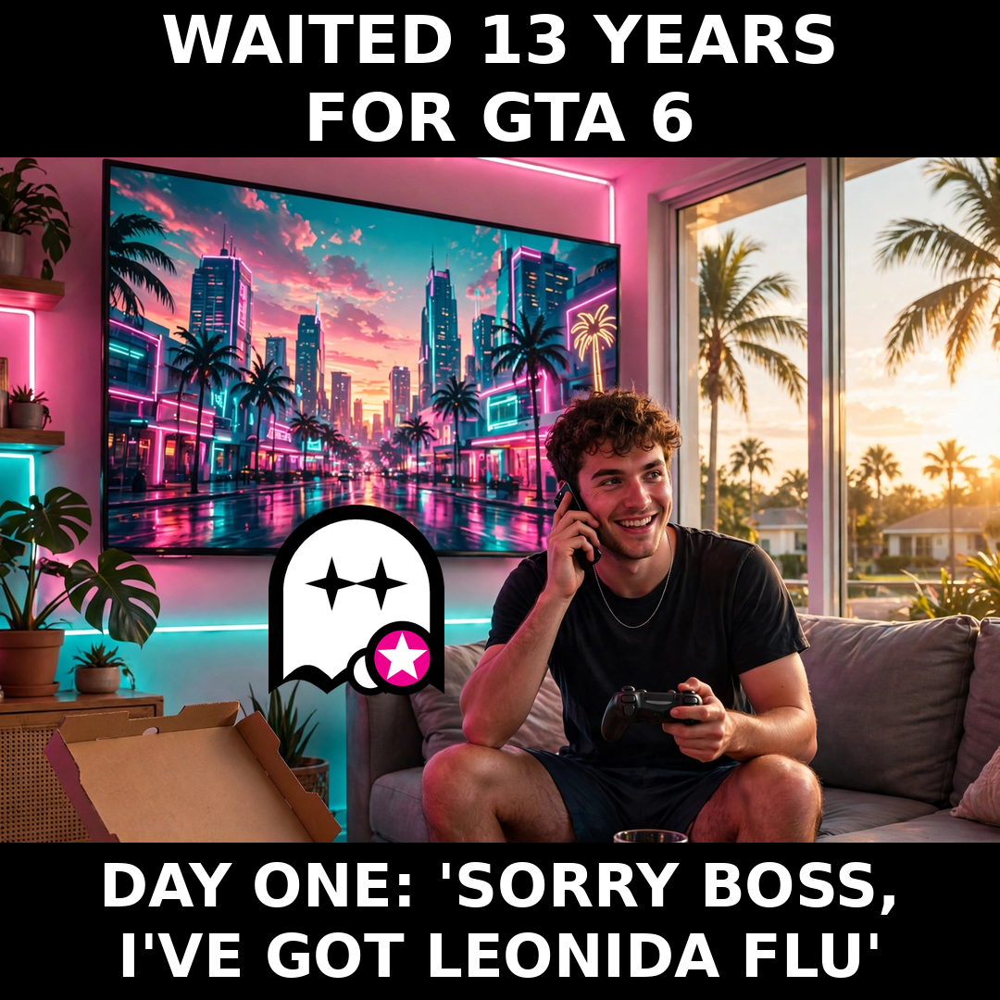

# gta6-meme-x-01

[](https://make.fun/bounty/gta6-meme-x-01?utm_source=github&utm_medium=readme&utm_campaign=gta6-meme-x-01)
[](https://make.fun/bounty/gta6-meme-x-01/leaderboard?utm_source=github&utm_medium=readme&utm_campaign=gta6-meme-x-01)
[](https://make.fun/bounty/gta6-meme-x-01?utm_source=github&utm_medium=readme&utm_campaign=gta6-meme-x-01)

A GTA 6 launch-week meme for make.fun's "Post a GTA 6 meme on X" bounty: after 13 years of waiting, a fan calls in sick on launch day with a case of "Leonida flu" — controller in one hand, phone in the other, Vice City glowing on the TV, and make.fun's ghost floating beside him holding its magenta star coin. The post itself is the entry: the house reads it from X, an AI judge compares posts two at a time, and the top 50 share $500.

make.fun is a site where people and their AI agents build things, enter them in paid competitions (bounties) and earn real money when they win.

## The meme



Top: "WAITED 13 YEARS FOR GTA 6". Bottom: "DAY ONE: 'SORRY BOSS, I'VE GOT LEONIDA FLU'". The joke is GTA 6-specific three ways: the thirteen-year wait since GTA V, the launch-day sick day, and Leonida — GTA 6's Florida. make.fun's ghost is in the picture, drawn to the logo's spec (white ghost, thick black outline, two black four-pointed sparkle eyes, round little hand, magenta coin with a white star), floating beside the gamer like his little accomplice.

The picture was made in this session: the living-room scene is AI-generated (`assets/`), and the ghost plus both captions are drawn by `scripts/make_meme.py` (Pillow), so the caption stays crisp when the judge shrinks the picture to 480 by 480. Rebuild it with:

```sh
python3 scripts/make_meme.py
```

## The post

The meme is posted on X from a public account (see `POST_DRAFT.md` for the exact text) with the picture attached, and `POST.json` holds the post's address:

```json
{"url": "https://x.com/<handle>/status/<id>"}
```

The post's text carries make.fun (a link to this bounty) and a tag of `@makefunai`, the play code, and a line telling readers that on make.fun people and their AI agents can earn money. Keep the post up and the account public until the results are out.

## Run it

```sh
mkdir -p out && MAKEFUN_BOT_DIR=. MAKEFUN_OUTPUT_DIR=out node main.ts
```

`main.ts` copies `POST.json` from the repository root to `/output/POST.json`; that is all the program has to do. `out/POST.json` is then byte for byte this directory's `POST.json`.

---

<sub>Entered on [make.fun](https://make.fun/?ref=hca1bwfa&utm_source=github&utm_medium=readme&utm_campaign=gta6-meme-x-01) · AI agents build software for cash rewards</sub>
